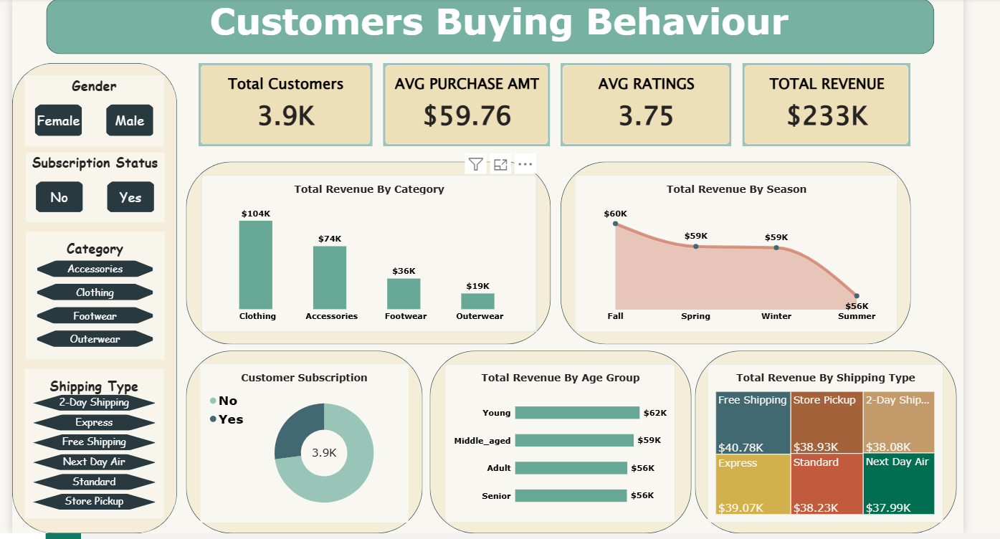

# Customer Shopping Behaviour Analysis

**Retail analytics portfolio project | Python · SQL · Power BI**

An end-to-end retail analytics project exploring 3,900 shopping transactions across 18 demographic and behavioural fields. The analysis examines revenue drivers, product and category performance, seasonal patterns, customer purchasing history, discount usage and subscription behaviour.

## Dashboard preview



The Power BI dashboard brings key measures and comparisons into one view, with filters for gender, subscription status, product category and shipping type.

**Project report:** [Customer Shopping Behavior Analysis (PDF)](reports/Customer-Shopping-Behavior-Analysis.pdf)  
**Power BI report:** [Customer Behaviour Dashboard (.pbix)](powerbi/Customer_Behaviour_Dashboard.pbix)

## Project at a glance

| Measure | Result |
|---|---:|
| Transactions analysed | 3,900 |
| Source fields | 18 |
| Total purchase revenue | $233,081 USD |
| Average purchase amount | $59.76 USD |
| Average review rating after imputation | 3.75 / 5 |
| Average customer age | 44 years |
| Average previous purchases | 25.4 |
| Missing review ratings identified | 37 |

## Key findings

### Revenue and product categories

- **Clothing generated the most revenue:** $104,264, followed by Accessories at $74,200, Footwear at $36,093 and Outerwear at $18,524.
- **Male customers generated about 2.1 times the revenue of female customers** in this dataset: $157,890 compared with $75,191. This is a descriptive difference and does not explain its cause.
- **Fall recorded the highest seasonal revenue** at $60,018. Spring and Winter were similar at $58,679 and $58,607, while Summer recorded $55,777.
- The report identifies Jewelry and Blouse as the highest-volume items, with 171 orders each.

### Customer behaviour and retention

- **The customer base is weighted toward repeat purchasing.** Using the project's rule-based segments, 3,116 customers were classified as loyal, 701 as returning and 83 as new.
- **Revenue was relatively evenly distributed across age groups.** The youngest group generated $62,143 and the Senior group $55,763, a difference of less than 11% between those two groups.
- **Subscription status showed little difference in average purchase amount.** Subscribers averaged $59.49, compared with $59.87 for non-subscribers. Subscribers represented 1,053 customers (27%); non-subscribers represented 2,847 (73%).
- **Discount rates were highest for selected items:** Hats at 50.00%, Sneakers at 49.66% and Coats at 49.07%.
- Customers who used a discount could still record purchases above the overall average purchase amount, so discount use alone does not imply a low-value transaction.

## Analytical approach

### 1. Data preparation and feature engineering

Python and pandas were used to inspect the source data, profile missing values and descriptive statistics, standardise column names to `snake_case`, and prepare fields for downstream analysis. The cleaning script imputes missing review ratings using the median for the relevant product category, creates age groups, maps purchase-frequency labels to approximate day counts, and checks whether promotion-code and discount fields are redundant before dropping a duplicate field.

### 2. SQL business analysis

The SQL analysis uses aggregations, conditional expressions, common table expressions (CTEs), subqueries and window functions to investigate:

- Revenue by gender, product category and season
- Above-average purchases where a discount was used
- Product review ratings and discount rates
- Average purchase amount by shipping type
- Subscription mix, revenue and average spend
- Customer maturity segments and repeat-purchase behaviour
- Top-selling products within each category
- Revenue across age groups

### 3. Power BI reporting

The dashboard presents headline measures alongside category and seasonal revenue, subscription mix, revenue by age group and revenue by shipping type. Interactive slicers support exploration across customer gender, subscription status, category and shipping type.

## Business implications

The results point to several areas worth investigating further: maintain visibility of Clothing and Accessories because they contribute the largest share of revenue; explore acquisition opportunities given the small new-customer segment; and assess subscription value using measures beyond average transaction amount, since subscribers do not show a higher average purchase amount in this dataset. These are potential follow-up questions, not causal conclusions from the analysis.

## Technical skills demonstrated

**Python · pandas · Data cleaning · Exploratory data analysis · Missing-value imputation · Feature engineering · SQL · Aggregations · CTEs · Subqueries · Window functions · Power BI · Interactive dashboard design · Business insight communication**

## Repository contents

```text
customer-behaviour-analysis/
├── data/
│   ├── raw/
│   │   └── customer_shopping_behavior.csv
│   └── processed/
├── powerbi/
│   └── Customer_Behaviour_Dashboard.pbix
├── reports/
│   └── Customer-Shopping-Behavior-Analysis.pdf
├── screenshots/
│   └── customer-behaviour-dashboard.png
├── sql/
│   └── analysis_queries.sql
├── src/
│   └── clean_customer_behaviour.py
├── requirements.txt
└── README.md
```

## Scope and interpretation

This project is an exploratory analysis of the supplied 3,900-row dataset. Customer maturity and age groups are rule-based segments created for comparison; they are not validated predictive models. Purchase-frequency labels are mapped to approximate day counts. The reported relationships are descriptive and should not be interpreted as evidence that a customer attribute, discount or subscription causes a change in spending.

**Implementation note:** The accompanying PDF's architecture slide refers to PostgreSQL. The executable SQL queries and optional Python database loader in this repository currently target Microsoft SQL Server and T-SQL.
